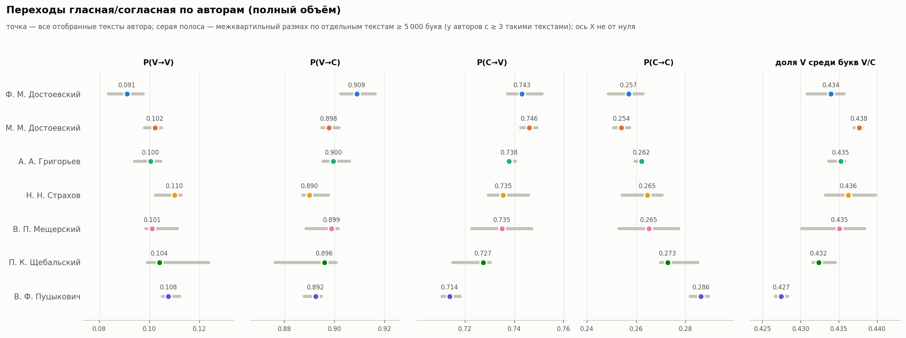
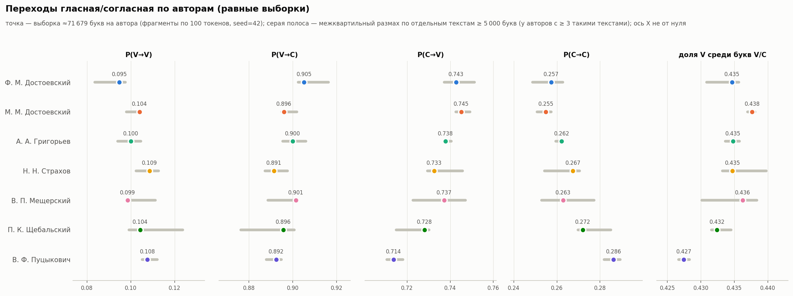
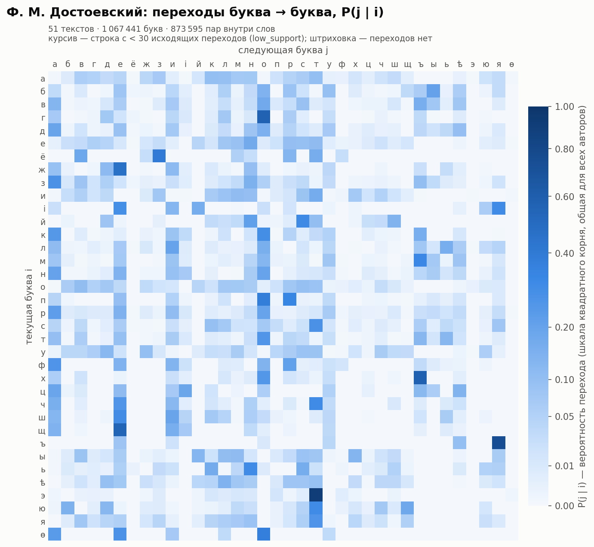
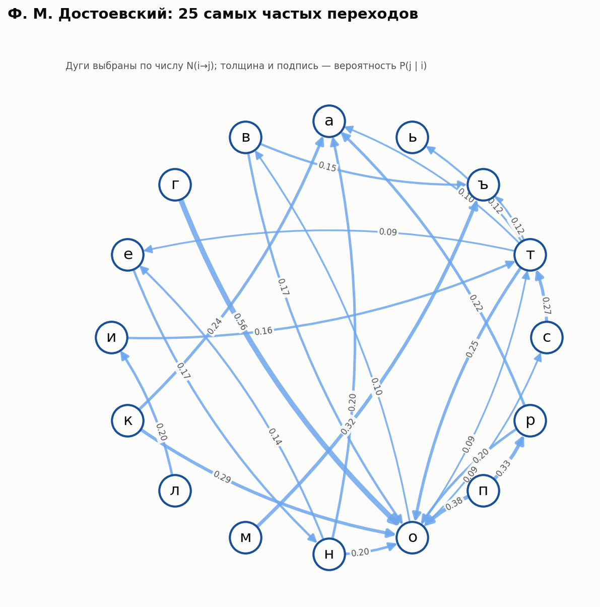
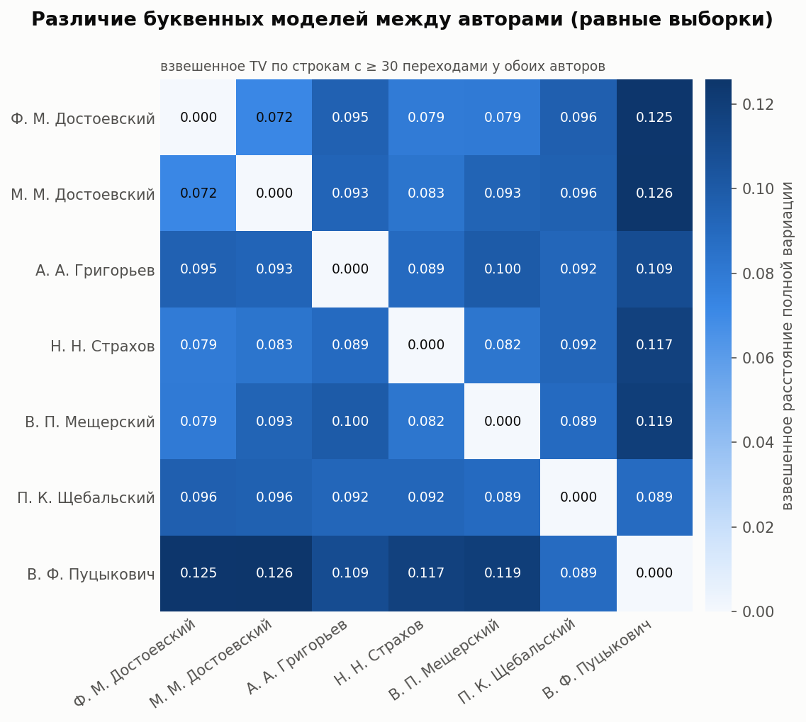
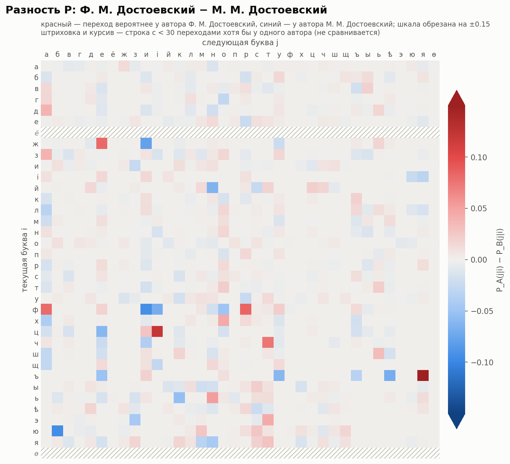
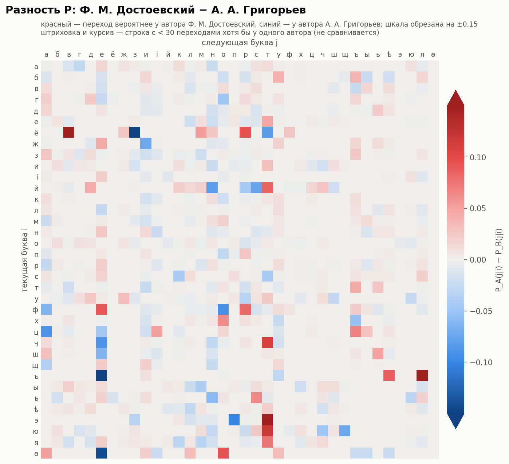
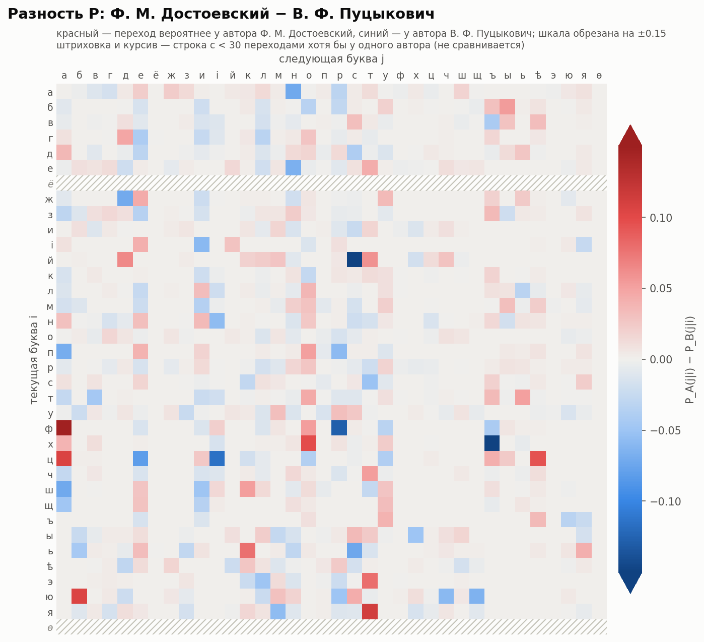
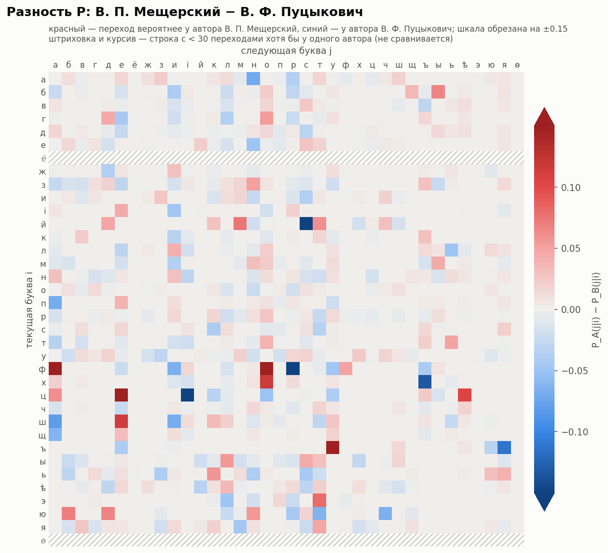
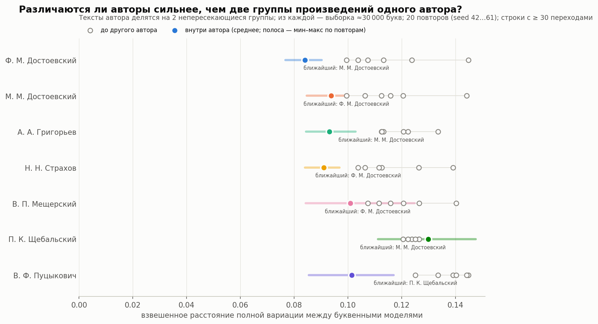

# Марковские модели первого порядка для текстов разных авторов СМАЛТ

*Отчёт сгенерирован программой `python -m markov.cli`; все числа — результат этого запуска.*

## Кратко

- Корпус: **107 текстов 7 авторов** из СМАЛТ, только тексты со статусом «Эталон» (`AUTHOR_VERIFY=1`) и «Статья проверена» (`STATUS=2`); журнальная публицистика и критика 1848–1896 гг. в дореформенной орфографии.
- Построены обе модели для каждого автора: цепь по буквам (36 состояний, включая ѣ, і, ѳ) и цепь «гласная/согласная»; переходы считаются только внутри слов.
- Буквенные модели разных авторов различаются в среднем сильнее, чем модели двух групп произведений одного автора, **но не у всех**: у 6 из 7 авторов все остальные авторы дальше, чем вторая группа его же произведений; у автора П. К. Щебальский (6 из 6) есть авторы ближе. Подробно — раздел 4.4.
- Пробная атрибуция по Хмелёву (leave-one-text-out, текстов: 102): верно **78%** при доле самого частого автора 46%. Ошибки сосредоточены на тематически однородных рубриках (например, 5 из 11 текстов «Иностранные события» отнесены не к тому автору). Это предварительная проверка, а не оценка метода.
- Многие крупные различия отдельных переходов объясняются небольшим числом слов (см. таблицы с примерами слов): лексика и тема заметно влияют на буквенные модели.

## 1. Постановка задачи

По письму руководителя от 04.10.2026: на размеченных текстах СМАЛТ построить и визуализировать простейшие марковские модели — переходы между буквами и между классами «гласная/согласная» (ср. А. А. Марков, 1913; Д. В. Хмелёв, 2000) — для разных авторов и посмотреть, чем они отличаются. Это **описательный эксперимент**: задача атрибуции здесь не решается и точность метода не утверждается.

## 2. Данные

**Источник.** Локальный дамп СМАЛТ `smalt.sql.20260115.070144.gz` (MySQL 8.0.44, создан 15.01.2026, SHA-256 `75e51b17d76cfc07308ee6cd3aa0e5c241d7c64b2074376fe13fb7298519a275`). Дамп читался потоково без выполнения SQL, только таблицы `author`, `author_types`, `text`, `magazine`, `textlist_*`, `word`; служебные таблицы пользователей и сессий не читались.

**Критерии отбора** (значения кодов взяты из исходного кода pysmalt — формы `import_form.html` и модели `TblText`):

- `AUTHOR_VERIFY = 1` — «Эталон» (0 — «Dubia»); `STATUS = 2` — «Статья проверена»; `CATEGORY = 0` — статья не скрыта; `INUSE1 = 1`.
- Авторы: все, у кого среди таких текстов ≥ 4 произведения и ≥ 10 000 словоупотреблений, кроме записи «Dubia». Тексты под псевдонимами и криптонимами, заведёнными в СМАЛТ как отдельные «авторы» (например, «Страхов Н.», «Кн. В. Мещерский»), не объединялись с основным автором, чтобы не вносить собственных атрибуций.
- Исключены вручную (`config.json → exclude_texts`): дубликат text.ID=347 (= 209), два перевода М. М. Достоевского из Шиллера, его частные письма (иной жанр). Автоматически исключён text.ID=45: ъ на конце слов есть, а ѣ заменена на е при наборе.
- Порядок слов восстанавливается по `CHAPTER_INDEX, PARAGRAPH_INDEX, SENTENCE_INDEX, WORD_INDEX` (как в `TblText.get_content`), при равенстве — по `ID_WORD`. Поле `WORDORDER` во многих текстах равно 0 и не используется. Пунктуации в таблице `word` нет — каждый токен является словом (иногда с дефисом, цифрами, латиницей).
- Полный список отобранных и исключённых текстов: `data/manifest.csv`, `data/excluded_texts.csv`.

| Автор | Текстов | Годы | Издания (число текстов) | Слов | Букв | Пар букв | Пар V/C |
|---|---|---|---|---|---|---|---|
| Ф. М. Достоевский | 51 | 1861–1874 | Гражданин (24); Время (20); Эпоха (6); Санкт-Петербургские Ведомости (1) | 192 169 | 1 067 441 | 873 595 | 792 205 |
| М. М. Достоевский | 5 | 1848–1860 | Пантеон и репертуар русской сцены (2); Светоч (2); Пантеон: Журнал литературно-художественный (1) | 25 078 | 142 208 | 116 838 | 106 428 |
| А. А. Григорьев | 7 | 1861–1862 | Время (7) | 48 785 | 288 140 | 239 450 | 219 468 |
| Н. Н. Страхов | 9 | 1861–1896 | Время (4); Библиотека для чтения (2); Отечественные записки (1); Заря (1); Разное (1) | 54 112 | 319 135 | 264 991 | 242 427 |
| В. П. Мещерский | 25 | 1872–1874 | Гражданин (25) | 54 326 | 306 181 | 251 466 | 229 142 |
| П. К. Щебальский | 4 | 1868–1871 | Русский Вестник (4) | 33 126 | 199 448 | 166 463 | 152 576 |
| В. Ф. Пуцыкович | 6 | 1873–1874 | Гражданин (6) | 11 037 | 71 679 | 60 657 | 55 620 |

**Дисбаланс объёмов:** от 71 679 букв (В. Ф. Пуцыкович) до 1 067 441 (Ф. М. Достоевский), в 15 раз. Поэтому все сравнения повторены на **равных выборках** по ≈71 679 букв на автора (фрагменты по 100 подряд идущих слов, перемешанные с seed=42); у самого малого автора (В. Ф. Пуцыкович) равная выборка совпадает со всем его корпусом.

**Жанр и время** различаются (см. колонку «Издания»): Ф. М. Достоевский — «Время»/«Эпоха» 1861–1865 и «Гражданин» 1873–1874 («Дневник писателя», «Иностранные события»); Григорьев — «Время» 1861–1862; Страхов — «Время» и другие издания 1861–1896; Мещерский и Пуцыкович — «Гражданин» 1872–1874; Щебальский — «Русский вестник» 1868–1871; М. М. Достоевский — журналы 1848–1860. Почти все тексты Пуцыковича — обзоры иностранной политики, что даёт тематический перекос.

**Орфография.** Все отобранные тексты набраны в дореформенной орфографии (ѣ, і, конечный ъ). При аудите символов найдено:

- в большинстве текстов «і десятеричное» набрано **латинской i** (U+0069), а в части текстов — кириллической і (U+0456). Это особенность набора, а не авторский признак. В 23 102 кириллических словах латинские двойники заменены на кириллицу (правило: только если после замены слово целиком кириллическое; латинские слова не трогаются);
- знаки ударения (U+0300/U+0301, например «что̀», «чтó») удалены; ө (U+04E9) в словах вроде «өома» приведена к ѳ;
- ѵ (ижица) не встретилась ни разу; ё встречается единично (строка ё помечена как малообеспеченная у большинства авторов);
- символы вне алфавита (латиница в иностранных словах, цифры, дефисы) разрывают цепочку и учтены в `results/unsupported_chars.csv`.

Доля исторических букв по авторам (на 1000 букв после нормализации):

| Автор | ѣ | і | ѳ | ё | ъ |
|---|---|---|---|---|---|
| Ф. М. Достоевский | 19.92 | 9.05 | 0.04 | 0.04 | 49.03 |
| М. М. Достоевский | 20.35 | 10.40 | 0.09 | 0.00 | 49.42 |
| А. А. Григорьев | 18.46 | 12.33 | 0.16 | 0.19 | 45.19 |
| Н. Н. Страхов | 19.15 | 12.68 | 0.09 | 0.05 | 45.13 |
| В. П. Мещерский | 18.50 | 11.63 | 0.01 | 0.01 | 47.20 |
| П. К. Щебальский | 18.83 | 14.28 | 0.01 | 0.01 | 46.90 |
| В. Ф. Пуцыкович | 16.66 | 17.17 | 0.00 | 0.03 | 45.51 |

## 3. Метод

- **Нормализация** (одинаковая для всех): Unicode NFC → нижний регистр → удаление знаков ударения → исправление латинских двойников. Режим орфографии `original`: ѣ, і, ѳ — отдельные состояния, ё не сливается с е, конечный ъ сохраняется.
- **Модель A (буквы):** 36 состояний в порядке дореформенного алфавита: `а б в г д е ё ж з и і й к л м н о п р с т у ф х ц ч ш щ ъ ы ь ѣ э ю я ѳ`. ъ и ь — обычные буквы. Переход i→j учитывается, только если j стоит сразу после i **внутри одного слова** (`cross_word=false`); пробел, дефис, цифра, латинская буква разрывают цепочку; переходов между текстами нет.
- **Модель B (V/C):** гласные `аеёиоуыэюяѣі` (включая ѣ и і), согласные `бвгджзйклмнпрстфхцчшщѳ` (включая ѳ); ъ и ь не относятся ни к одному классу и **разрывают** цепочку. Поэтому пар V/C меньше, чем пар букв.
- N(i,j) — число переходов; P(j|i) = N(i,j) / Σ_j N(i,j). Строки без исходящих переходов не оцениваются (NaN, штриховка на рисунках); сглаживание в описательных матрицах не применяется. Для каждого автора проверено `сумма N = число пар`.
- **low_support:** строка с < 30 исходящих переходов не используется в сравнениях (технический порог, не статистический критерий).
- **Расстояние между буквенными моделями:** взвешенное расстояние полной вариации D = Σ_i w_i · ½ Σ_j |P_A(j|i) − P_B(j|i)| по строкам, обеспеченным у обоих авторов; w_i — средняя доля переходов из буквы i. 0 — одинаковые модели. Мера описательная и зависит от объёма выборки (на малых выборках больше из-за шума), поэтому сравнивать её можно только при равных объёмах.

## 4. Результаты

### 4.1. Модель «гласная/согласная»

P(X→Y) — условная вероятность, что за буквой класса X внутри слова следует буква класса Y; в скобках — число таких переходов. «Доля V» — маргинальная доля гласных среди букв, отнесённых к V/C (это не вероятность перехода).

**Полный объём:**

| Автор | P(V→V) | P(V→C) | P(C→V) | P(C→C) | доля V | пар V/C |
|---|---|---|---|---|---|---|
| Ф. М. Достоевский | 0.091 (28 376) | 0.909 (283 266) | 0.743 (357 093) | 0.257 (123 470) | 0.434 | 792 205 |
| М. М. Достоевский | 0.102 (4 345) | 0.898 (38 151) | 0.746 (47 696) | 0.254 (16 236) | 0.438 | 106 428 |
| А. А. Григорьев | 0.100 (8 762) | 0.900 (78 490) | 0.738 (97 560) | 0.262 (34 656) | 0.435 | 219 468 |
| Н. Н. Страхов | 0.110 (10 664) | 0.890 (86 303) | 0.735 (106 978) | 0.265 (38 482) | 0.436 | 242 427 |
| В. П. Мещерский | 0.101 (9 103) | 0.899 (80 896) | 0.735 (102 257) | 0.265 (36 886) | 0.435 | 229 142 |
| П. К. Щебальский | 0.104 (6 323) | 0.896 (54 474) | 0.727 (66 751) | 0.273 (25 028) | 0.432 | 152 576 |
| В. Ф. Пуцыкович | 0.108 (2 375) | 0.892 (19 706) | 0.714 (23 937) | 0.286 (9 602) | 0.427 | 55 620 |

**Равные выборки (≈71 679 букв на автора):**

| Автор | P(V→V) | P(V→C) | P(C→V) | P(C→C) | доля V | пар V/C |
|---|---|---|---|---|---|---|
| Ф. М. Достоевский | 0.095 (1 991) | 0.905 (19 006) | 0.743 (24 111) | 0.257 (8 354) | 0.435 | 53 462 |
| М. М. Достоевский | 0.104 (2 237) | 0.896 (19 272) | 0.745 (24 019) | 0.255 (8 217) | 0.438 | 53 745 |
| А. А. Григорьев | 0.100 (2 190) | 0.900 (19 698) | 0.738 (24 481) | 0.262 (8 701) | 0.435 | 55 070 |
| Н. Н. Страхов | 0.109 (2 376) | 0.891 (19 517) | 0.733 (24 114) | 0.267 (8 804) | 0.435 | 54 811 |
| В. П. Мещерский | 0.099 (2 077) | 0.901 (18 994) | 0.737 (24 009) | 0.263 (8 561) | 0.436 | 53 641 |
| П. К. Щебальский | 0.104 (2 302) | 0.896 (19 769) | 0.728 (24 167) | 0.272 (9 028) | 0.432 | 55 266 |
| В. Ф. Пуцыкович | 0.108 (2 375) | 0.892 (19 706) | 0.714 (23 937) | 0.286 (9 602) | 0.427 | 55 620 |





Серая полоса — межквартильный размах той же величины по отдельным текстам автора (тексты ≥ 5 000 букв). Если полосы авторов перекрываются, различие объединённых значений не стоит считать устойчивым признаком автора.

Тепловые карты V/C по авторам: [Ф. М. Достоевский](figures/vc_heatmap_dostoevsky_fm.png), [М. М. Достоевский](figures/vc_heatmap_dostoevsky_mm.png), [А. А. Григорьев](figures/vc_heatmap_grigoryev.png), [Н. Н. Страхов](figures/vc_heatmap_strakhov.png), [В. П. Мещерский](figures/vc_heatmap_meshchersky.png), [П. К. Щебальский](figures/vc_heatmap_shchebalsky.png), [В. Ф. Пуцыкович](figures/vc_heatmap_putsykovich.png).

### 4.2. Модель «буква → буква»

Для каждого автора: тепловая карта P (общая шкала квадратного корня для всех авторов), карта N (логарифмическая шкала) и граф 25 самых частых переходов.

| Автор | P (тепловая карта) | N | Граф частых переходов | Строки low_support |
|---|---|---|---|---|
| Ф. М. Достоевский | [letter_heatmap_dostoevsky_fm.png](figures/letter_heatmap_dostoevsky_fm.png) | [letter_counts_dostoevsky_fm.png](figures/letter_counts_dostoevsky_fm.png) | [letter_top_graph_dostoevsky_fm.png](figures/letter_top_graph_dostoevsky_fm.png) | — |
| М. М. Достоевский | [letter_heatmap_dostoevsky_mm.png](figures/letter_heatmap_dostoevsky_mm.png) | [letter_counts_dostoevsky_mm.png](figures/letter_counts_dostoevsky_mm.png) | [letter_top_graph_dostoevsky_mm.png](figures/letter_top_graph_dostoevsky_mm.png) | ё, ѳ |
| А. А. Григорьев | [letter_heatmap_grigoryev.png](figures/letter_heatmap_grigoryev.png) | [letter_counts_grigoryev.png](figures/letter_counts_grigoryev.png) | [letter_top_graph_grigoryev.png](figures/letter_top_graph_grigoryev.png) | — |
| Н. Н. Страхов | [letter_heatmap_strakhov.png](figures/letter_heatmap_strakhov.png) | [letter_counts_strakhov.png](figures/letter_counts_strakhov.png) | [letter_top_graph_strakhov.png](figures/letter_top_graph_strakhov.png) | ё, ѳ |
| В. П. Мещерский | [letter_heatmap_meshchersky.png](figures/letter_heatmap_meshchersky.png) | [letter_counts_meshchersky.png](figures/letter_counts_meshchersky.png) | [letter_top_graph_meshchersky.png](figures/letter_top_graph_meshchersky.png) | ё, ѳ |
| П. К. Щебальский | [letter_heatmap_shchebalsky.png](figures/letter_heatmap_shchebalsky.png) | [letter_counts_shchebalsky.png](figures/letter_counts_shchebalsky.png) | [letter_top_graph_shchebalsky.png](figures/letter_top_graph_shchebalsky.png) | ё, ѳ |
| В. Ф. Пуцыкович | [letter_heatmap_putsykovich.png](figures/letter_heatmap_putsykovich.png) | [letter_counts_putsykovich.png](figures/letter_counts_putsykovich.png) | [letter_top_graph_putsykovich.png](figures/letter_top_graph_putsykovich.png) | ё, ѳ |





**Топ-10 переходов по числу N** (в скобках — P(j|i) и знаменатель: все переходы из буквы i):

| # | Ф. М. Достоевский | М. М. Достоевский | А. А. Григорьев | Н. Н. Страхов | В. П. Мещерский | П. К. Щебальский | В. Ф. Пуцыкович |
|---|---|---|---|---|---|---|---|
| 1 | т→о 17 960 (0.25 из 70 464) | т→о 2 133 (0.23 из 9 145) | с→т 4 747 (0.31 из 15 126) | с→т 5 458 (0.32 из 17 310) | с→т 4 892 (0.29 из 16 999) | с→т 3 330 (0.30 из 11 056) | с→т 1 262 (0.32 из 3 918) |
| 2 | с→т 15 273 (0.27 из 56 266) | с→т 2 007 (0.27 из 7 432) | т→о 4 187 (0.25 из 16 900) | т→о 5 327 (0.24 из 21 994) | т→о 4 866 (0.25 из 19 553) | т→о 2 761 (0.23 из 11 815) | е→н 931 (0.24 из 3 926) |
| 3 | н→а 13 975 (0.20 из 70 342) | н→а 1 743 (0.19 из 9 172) | н→о 3 968 (0.20 из 19 610) | н→о 4 293 (0.20 из 21 487) | н→а 3 875 (0.20 из 19 311) | н→о 2 473 (0.18 из 13 592) | т→о 916 (0.21 из 4 371) |
| 4 | н→о 13 836 (0.20 из 70 342) | н→о 1 660 (0.18 из 9 172) | н→а 3 808 (0.19 из 19 610) | н→а 3 912 (0.18 из 21 487) | н→о 3 556 (0.18 из 19 311) | н→а 2 346 (0.17 из 13 592) | н→о 856 (0.17 из 4 979) |
| 5 | м→ъ 10 947 (0.32 из 33 949) | м→ъ 1 506 (0.33 из 4 512) | р→а 2 995 (0.25 из 12 099) | м→ъ 3 144 (0.31 из 10 222) | г→о 3 088 (0.59 из 5 224) | р→а 2 228 (0.25 из 8 895) | н→а 842 (0.17 из 4 979) |
| 6 | н→е 9 812 (0.14 из 70 342) | р→а 1 383 (0.24 из 5 830) | г→о 2 958 (0.61 из 4 827) | е→н 3 065 (0.18 из 16 991) | е→н 3 045 (0.19 из 16 124) | е→н 2 093 (0.20 из 10 382) | п→р 835 (0.38 из 2 172) |
| 7 | п→о 9 619 (0.38 из 25 447) | п→о 1 342 (0.39 из 3 430) | м→ъ 2 951 (0.32 из 9 309) | к→о 2 930 (0.32 из 9 282) | м→ъ 2 919 (0.31 из 9 481) | г→о 1 993 (0.58 из 3 453) | р→а 778 (0.23 из 3 392) |
| 8 | г→о 9 597 (0.56 из 16 995) | к→о 1 332 (0.30 из 4 394) | к→о 2 889 (0.31 из 9 359) | р→а 2 833 (0.22 из 12 670) | о→с 2 706 (0.11 из 24 741) | м→ъ 1 927 (0.31 из 6 203) | п→о 711 (0.33 из 2 172) |
| 9 | е→н 9 346 (0.17 из 54 771) | г→о 1 305 (0.59 из 2 204) | е→н 2 865 (0.19 из 14 991) | т→ъ 2 832 (0.13 из 21 994) | р→а 2 692 (0.22 из 12 520) | п→р 1 898 (0.37 из 5 152) | м→ъ 677 (0.32 из 2 096) |
| 10 | р→а 9 330 (0.22 из 42 097) | н→е 1 248 (0.14 из 9 172) | п→о 2 644 (0.41 из 6 526) | п→о 2 684 (0.37 из 7 205) | п→р 2 689 (0.39 из 6 886) | к→о 1 794 (0.32 из 5 635) | г→о 675 (0.54 из 1 256) |

Верхние строки почти совпадают у всех авторов (то, ст, на, но, мъ, го…): самые частые переходы отражают общие свойства языка и орфографии, а не автора. Различия ищутся в условных вероятностях, ниже.

### 4.3. Сравнение буквенных моделей авторов

**Попарные расстояния D (полный объём):**

|  | Ф. М. Достоевский | М. М. Достоевский | А. А. Григорьев | Н. Н. Страхов | В. П. Мещерский | П. К. Щебальский | В. Ф. Пуцыкович |
|---|---|---|---|---|---|---|---|
| Ф. М. Достоевский | — | 0.062 | 0.081 | 0.067 | 0.068 | 0.090 | 0.123 |
| М. М. Достоевский | 0.062 | — | 0.079 | 0.072 | 0.083 | 0.091 | 0.122 |
| А. А. Григорьев | 0.081 | 0.079 | — | 0.080 | 0.089 | 0.084 | 0.106 |
| Н. Н. Страхов | 0.067 | 0.072 | 0.080 | — | 0.078 | 0.087 | 0.116 |
| В. П. Мещерский | 0.068 | 0.083 | 0.089 | 0.078 | — | 0.081 | 0.114 |
| П. К. Щебальский | 0.090 | 0.091 | 0.084 | 0.087 | 0.081 | — | 0.085 |
| В. Ф. Пуцыкович | 0.123 | 0.122 | 0.106 | 0.116 | 0.114 | 0.085 | — |

**Попарные расстояния D (равные выборки):**

|  | Ф. М. Достоевский | М. М. Достоевский | А. А. Григорьев | Н. Н. Страхов | В. П. Мещерский | П. К. Щебальский | В. Ф. Пуцыкович |
|---|---|---|---|---|---|---|---|
| Ф. М. Достоевский | — | 0.072 | 0.095 | 0.079 | 0.079 | 0.096 | 0.125 |
| М. М. Достоевский | 0.072 | — | 0.093 | 0.083 | 0.093 | 0.096 | 0.126 |
| А. А. Григорьев | 0.095 | 0.093 | — | 0.089 | 0.100 | 0.092 | 0.109 |
| Н. Н. Страхов | 0.079 | 0.083 | 0.089 | — | 0.082 | 0.092 | 0.117 |
| В. П. Мещерский | 0.079 | 0.093 | 0.100 | 0.082 | — | 0.089 | 0.119 |
| П. К. Щебальский | 0.096 | 0.096 | 0.092 | 0.092 | 0.089 | — | 0.089 |
| В. Ф. Пуцыкович | 0.125 | 0.126 | 0.109 | 0.117 | 0.119 | 0.089 | — |



**Разностные тепловые карты** P_A − P_B (один алфавит, симметричная шкала, штриховкой — строки low_support хотя бы у одного автора):

#### Ф. М. Достоевский − М. М. Достоевский



Наибольшие |ΔP| среди строк, обеспеченных у обоих (P (N из знаменателя)); для каждого перехода — пять слов, дающих больше всего его вхождений, и их доля от всех вхождений:

| переход | Ф. М. Достоевский | М. М. Достоевский | ΔP | слова: Ф. М. Достоевский | слова: М. М. Достоевский |
|---|---|---|---|---|---|
| ъ→я | 0.750 (228 из 304) | 0.567 (17 из 30) | +0.183 | объявленіи (19), объявилъ (13), объявленіе (13), объяснить (12) [25%] | объявляетъ (2), объяснить (2), объявленія (1), объяснивъ (1) [35%] |
| ц→і | 0.185 (606 из 3 277) | 0.064 (31 из 487) | +0.121 | франціи (64), редакціи (41), редакція (34), франція (25) [27%] | цивилизаціи (4), франціи (3), цивилизацію (3), протекцію (2) [39%] |
| ю→б | 0.146 (421 из 2 891) | 0.240 (96 из 400) | -0.094 | любви (30), любитъ (29), любовь (23), люблю (21) [24%] | любитъ (14), любви (11), любовь (7), полюбить (4) [38%] |
| ф→и | 0.135 (199 из 1 476) | 0.228 (38 из 167) | -0.093 | славянофилы (12), филиповичъ (9), фики (8), фигура (7) [18%] | философію (6), философическое (4), философіею (3), славянофилъ (3) [42%] |
| ф→р | 0.210 (310 из 1 476) | 0.126 (21 из 167) | +0.084 | франціи (64), франція (25), французы (13), францію (13) [37%] | франціи (3), фразы (2), французское (2), французскіе (2) [43%] |
| ж→е | 0.466 (5 749 из 12 338) | 0.385 (598 из 1 555) | +0.081 | же (1 087), даже (901), уже (582), можетъ (553) [54%] | же (87), уже (73), даже (58), можетъ (45) [44%] |
| ф→а | 0.260 (384 из 1 476) | 0.180 (30 из 167) | +0.081 | фактъ (49), факты (34), графа (30), фактовъ (21) [35%] | фактъ (4), фамилія (4), фантазіи (2), фантазію (2) [40%] |
| ж→и | 0.113 (1 392 из 12 338) | 0.191 (297 из 1 555) | -0.078 | жизни (172), жизнь (104), положимъ (67), жить (32) [27%] | жизни (75), жизнь (35), живетъ (11), принадлежитъ (8) [43%] |

#### Ф. М. Достоевский − А. А. Григорьев



Наибольшие |ΔP| среди строк, обеспеченных у обоих (P (N из знаменателя)); для каждого перехода — пять слов, дающих больше всего его вхождений, и их доля от всех вхождений:

| переход | Ф. М. Достоевский | А. А. Григорьев | ΔP | слова: Ф. М. Достоевский | слова: А. А. Григорьев |
|---|---|---|---|---|---|
| ё→з | 0.395 (15 из 38) | 0.722 (39 из 54) | -0.327 | серьёзно (5), серьёзнаго (3), серьёзное (2), серьёзною (1) [73%] | серьёзно (7), серьёзнаго (5), серьёзное (3), серьёзные (3) [46%] |
| ъ→е | 0.082 (25 из 304) | 0.315 (28 из 89) | -0.232 | разъединеніе (6), разъединенія (3), разъединяются (2), разъединено (1) [48%] | объективности (9), объективность (5), субъективнымъ (2), разъединенныхъ (2) [64%] |
| ё→в | 0.184 (7 из 38) | 0.000 (0 из 54) | +0.184 | бёву (3), бёвомъ (1), бёвъ (1), поддёвку (1) [86%] | — [0%] |
| ъ→я | 0.750 (228 из 304) | 0.584 (52 из 89) | +0.166 | объявленіи (19), объявилъ (13), объявленіе (13), объяснить (12) [25%] | объяснить (6), разъяснить (4), объясненія (3), необъятныя (3) [31%] |
| э→т | 0.915 (3 577 из 3 908) | 0.755 (794 из 1 052) | +0.161 | это (1 580), этомъ (309), этого (290), этотъ (249) [68%] | это (192), этого (72), этомъ (65), эти (58) [49%] |
| ѳ→е | 0.267 (8 из 30) | 0.409 (18 из 44) | -0.142 | ѳедоръ (2), ѳедя (1), парѳенія (1), ѳеодорѣ (1) [62%] | апоѳеоза (3), ѳеодора (3), парѳенія (2), апоѳеозой (2) [56%] |
| ю→т | 0.305 (883 из 2 891) | 0.186 (133 из 714) | +0.119 | знаютъ (29), понимаютъ (22), имѣютъ (20), бываютъ (18) [10%] | заключаются (8), являются (5), имѣютъ (4), представляютъ (4) [16%] |
| ч→т | 0.304 (5 376 из 17 666) | 0.196 (835 из 4 255) | +0.108 | что (4 072), чтобъ (321), почти (214), чтобы (150) [88%] | что (620), чтобы (62), почти (23), потомучто (19) [87%] |

#### Ф. М. Достоевский − В. Ф. Пуцыкович



Наибольшие |ΔP| среди строк, обеспеченных у обоих (P (N из знаменателя)); для каждого перехода — пять слов, дающих больше всего его вхождений, и их доля от всех вхождений:

| переход | Ф. М. Достоевский | В. Ф. Пуцыкович | ΔP | слова: Ф. М. Достоевский | слова: В. Ф. Пуцыкович |
|---|---|---|---|---|---|
| й→с | 0.310 (710 из 2 292) | 0.527 (87 из 165) | -0.217 | дѣйствительно (138), дѣйствительности (60), дѣйствительность (25), дѣйствовать (23) [35%] | бездѣйствіе (9), англійской (7), дѣйствія (5), англійскихъ (4) [29%] |
| х→ъ | 0.569 (5 352 из 9 401) | 0.739 (467 из 632) | -0.170 | ихъ (450), всѣхъ (270), нихъ (242), этихъ (159) [21%] | ихъ (26), всѣхъ (14), другихъ (13), своихъ (11) [14%] |
| ф→а | 0.260 (384 из 1 476) | 0.113 (23 из 204) | +0.147 | фактъ (49), факты (34), графа (30), фактовъ (21) [35%] | фавръ (4), наундорфа (4), графа (3), фактъ (2) [57%] |
| ф→р | 0.210 (310 из 1 476) | 0.338 (69 из 204) | -0.128 | франціи (64), франція (25), французы (13), францію (13) [37%] | франціи (19), французскаго (10), францію (8), французскихъ (5) [61%] |
| ц→і | 0.185 (606 из 3 277) | 0.301 (102 из 339) | -0.116 | франціи (64), редакціи (41), редакція (34), франція (25) [27%] | франціи (19), францію (8), національнаго (5), націи (4) [35%] |
| я→т | 0.261 (1 953 из 7 481) | 0.150 (81 из 541) | +0.111 | опять (125), говорятъ (79), дѣятельности (60), вѣроятно (41) [16%] | непринятіе (7), дѣятельности (4), говорятъ (4), принять (2) [21%] |
| ц→а | 0.188 (617 из 3 277) | 0.083 (28 из 339) | +0.106 | лица (47), сердца (23), двадцать (22), конца (15) [17%] | принца (3), мѣсяца (2), республиканцамъ (2), приверженцамъ (2) [32%] |
| ю→б | 0.146 (421 из 2 891) | 0.040 (9 из 223) | +0.105 | любви (30), любитъ (29), любовь (23), люблю (21) [24%] | любви (2), миролюбивой (2), миролюбивому (1), любятъ (1) [67%] |

#### В. П. Мещерский − В. Ф. Пуцыкович



Наибольшие |ΔP| среди строк, обеспеченных у обоих (P (N из знаменателя)); для каждого перехода — пять слов, дающих больше всего его вхождений, и их доля от всех вхождений:

| переход | В. П. Мещерский | В. Ф. Пуцыкович | ΔP | слова: В. П. Мещерский | слова: В. Ф. Пуцыкович |
|---|---|---|---|---|---|
| ф→р | 0.127 (47 из 371) | 0.338 (69 из 204) | -0.212 | франціи (19), франція (5), францію (4), фразы (4) [68%] | франціи (19), французскаго (10), францію (8), французскихъ (5) [61%] |
| й→с | 0.337 (158 из 469) | 0.527 (87 из 165) | -0.190 | дѣйствительно (22), дѣйствіе (10), самоубійствѣ (8), дѣйствовать (7) [30%] | бездѣйствіе (9), англійской (7), дѣйствія (5), англійскихъ (4) [29%] |
| ц→і | 0.111 (107 из 963) | 0.301 (102 из 339) | -0.190 | франціи (19), интеллигенціи (9), франція (5), администраціи (5) [36%] | франціи (19), францію (8), національнаго (5), націи (4) [35%] |
| ъ→у | 0.169 (12 из 71) | 0.000 (0 из 31) | +0.169 | съумѣетъ (3), съумѣли (2), съумѣлъ (2), съумѣютъ (1) [67%] | — [0%] |
| ф→о | 0.251 (93 из 371) | 0.083 (17 из 204) | +0.167 | реформы (23), реформа (20), реформамъ (9), реформъ (9) [66%] | реформъ (3), формы (2), реформы (2), реформенной (2) [53%] |
| ф→а | 0.272 (101 из 371) | 0.113 (23 из 204) | +0.159 | фактъ (31), фактовъ (5), фабрики (5), фабричнаго (5) [46%] | фавръ (4), наундорфа (4), графа (3), фактъ (2) [57%] |
| ц→е | 0.336 (324 из 963) | 0.189 (64 из 339) | +0.148 | церкви (140), церковь (64), церквей (22), церковью (17) [75%] | процесса (11), процессъ (5), сцены (4), принцевъ (4) [38%] |
| х→ъ | 0.606 (1 724 из 2 845) | 0.739 (467 из 632) | -0.133 | ихъ (109), всѣхъ (84), этихъ (64), нихъ (64) [19%] | ихъ (26), всѣхъ (14), другихъ (13), своихъ (11) [14%] |

Строки с малыми знаменателями (ё, ъ, ѳ, ф, э и т. п.) дают самые большие |ΔP|, но опираются на десятки–сотни переходов и несколько частых слов; на них нельзя опираться как на авторский признак без проверки на отдельных произведениях.

### 4.4. Вариация внутри автора и между авторами

Проверка того, превышают ли различия между авторами различия между **разными произведениями одного автора**. В каждом из 20 повторов тексты каждого автора случайно делятся на две непересекающиеся группы, из каждой берётся выборка ≈30 000 букв; «внутри» — D между двумя группами одного автора, «между» — D между первыми группами двух авторов. Объёмы выборок одинаковы, поэтому шумовое смещение D одинаково.



| Автор | D внутри (среднее; мин–макс) | ближайший другой автор, D | авторов ближе, чем своя вторая группа |
|---|---|---|---|
| Ф. М. Достоевский | 0.084 (0.077–0.090) | М. М. Достоевский, 0.099 | 0 из 6 |
| М. М. Достоевский | 0.094 (0.085–0.100) | Ф. М. Достоевский, 0.099 | 0 из 6 |
| А. А. Григорьев | 0.093 (0.084–0.103) | М. М. Достоевский, 0.113 | 0 из 6 |
| Н. Н. Страхов | 0.091 (0.084–0.097) | Ф. М. Достоевский, 0.104 | 0 из 6 |
| В. П. Мещерский | 0.101 (0.084–0.125) | Ф. М. Достоевский, 0.107 | 0 из 6 |
| П. К. Щебальский | 0.130 (0.111–0.148) | М. М. Достоевский, 0.121 | 6 из 6 |
| В. Ф. Пуцыкович | 0.101 (0.085–0.117) | П. К. Щебальский, 0.125 | 0 из 6 |

Среднее D внутри автора — 0.099, между авторами — 0.121. Разделение не полное: у авторов с тематически разнородными текстами (например, рецензия на «Войну и мир» и хроника франко-прусской войны у Щебальского) разные произведения одного автора различаются так же или сильнее, чем разные авторы.

### 4.5. Пробная атрибуция по схеме Хмелёва (предварительно, P4)

Для каждого текста ≥ 5 000 букв вычисляется Σ n_ij · log p̂_ij по буквенной модели каждого автора (p̂ со сглаживанием α = 0.5, только в этом разделе); модель «своего» автора строится без проверяемого текста (leave-one-text-out). Выбирается автор с максимальным правдоподобием.

| Автор | текстов | верно |
|---|---|---|
| Ф. М. Достоевский | 47 | 42 (89%) |
| М. М. Достоевский | 5 | 2 (40%) |
| А. А. Григорьев | 7 | 7 (100%) |
| Н. Н. Страхов | 9 | 7 (78%) |
| В. П. Мещерский | 24 | 17 (71%) |
| П. К. Щебальский | 4 | 1 (25%) |
| В. Ф. Пуцыкович | 6 | 4 (67%) |

Всего верно 80 из 102 (78%); доля самого частого автора 46%. Ошибочно отнесённые тексты:

| text.ID | автор (СМАЛТ) | отнесён к | пар | название |
|---|---|---|---|---|
| 96 | Ф. М. Достоевский | М. М. Достоевский | 6 000 | Голос за петербургского Дон–Кихота. (По поводу статей г. Театрина) |
| 207 | Ф. М. Достоевский | В. Ф. Пуцыкович | 7 130 | Иностранные события |
| 350 | Ф. М. Достоевский | П. К. Щебальский | 12 340 | Иностранные события |
| 351 | Ф. М. Достоевский | П. К. Щебальский | 10 563 | Иностранные события |
| 355 | Ф. М. Достоевский | П. К. Щебальский | 12 542 | Иностранные события |
| 23 | М. М. Достоевский | А. А. Григорьев | 36 338 | Жуковский и романтизм |
| 113 | М. М. Достоевский | Ф. М. Достоевский | 8 342 | Рассказы из народного русского быта Марка Вовчка. Москва, 1859 г. |
| 109 | М. М. Достоевский | Ф. М. Достоевский | 36 023 | Гроза. Драма в пяти действиях А. Н. Островского |
| 311 | В. П. Мещерский | Н. Н. Страхов | 8 512 | Рабочий вопрос. Статья вторая |
| 235 | В. П. Мещерский | А. А. Григорьев | 6 168 | Наполеон III |
| 222 | В. П. Мещерский | Ф. М. Достоевский | 12 891 | Мысли вслух. Признаки времени. Почему грустно живется. Нечто о романе. |
| 223 | В. П. Мещерский | Ф. М. Достоевский | 17 568 | Рассказ застрелившегося гимназиста. I. II |
| 182 | В. П. Мещерский | П. К. Щебальский | 13 503 | Неизбежные размышления. II. Люди, где же люди? |
| 230 | В. П. Мещерский | Ф. М. Достоевский | 22 559 | Рассказ застрелившегося гимназиста. IV. (Окончание) |
| 183 | В. П. Мещерский | Н. Н. Страхов | 15 564 | Неизбежные размышления. III. Нечто о современных священниках |
| 274 | В. Ф. Пуцыкович | П. К. Щебальский | 6 431 | Подлежит ли земство по закону ответственности за непринятие мер против |
| 277 | В. Ф. Пуцыкович | П. К. Щебальский | 19 171 | Иностранные события |
| 246 | П. К. Щебальский | Ф. М. Достоевский | 31 809 | Русская литература. Война и мир, соч. графа Л. Н. Толстого. Москва, 18 |
| 248 | П. К. Щебальский | В. Ф. Пуцыкович | 17 850 | Франко-германская война II |
| 245 | П. К. Щебальский | А. А. Григорьев | 106 458 | Идеалисты и реалисты. Общественное движение при Александре I, А. Н. Пы |
| 292 | Н. Н. Страхов | А. А. Григорьев | 21 667 | Наша изящная словесность. Статья третья. Полное собрание сочинений Ф.  |
| 296 | Н. Н. Страхов | Ф. М. Достоевский | 58 998 | Борьба с Западом в нашей литературе. Книжка третья |

Ограничения пробы: нет независимой тестовой выборки, у Ф. М. Достоевского почти половина текстов (модель «знает» его лучше), объёмы авторов несопоставимы, параметр сглаживания не подбирался. Число не является оценкой точности метода.

## 5. Наблюдения (числа из этого запуска)

1. На равных выборках P(V→V) у автора Ф. М. Достоевский — 0.095 (1 991 из 20 997 переходов из гласной), у автора Н. Н. Страхов — 0.109 (2 376 из 21 893); различие +0.014. Межквартильные размахи по текстам: [0.084; 0.098] и [0.102; 0.113] — не перекрываются.
1. P(C→C) максимальна у автора В. Ф. Пуцыкович — 0.286 (9 602 из 33 539), минимальна у автора М. М. Достоевский — 0.255 (8 217 из 32 236). Остальные авторы лежат между ними в интервале шириной 0.031: модель V/C различает авторов очень слабо.
1. Переход ю→б: у автора Ф. М. Достоевский P = 0.146 (421 из 2 891 исходящих), у автора М. М. Достоевский — 0.240 (96 из 400), ΔP = -0.094. Три слова дают 19% вхождений у первого (любви (30), любитъ (29), любовь (23)) и 33% у второго (любитъ (14), любви (11), любовь (7)), то есть различие во многом лексическое.
1. Переход э→т: у автора Ф. М. Достоевский P = 0.915 (3 577 из 3 908 исходящих), у автора А. А. Григорьев — 0.755 (794 из 1 052), ΔP = +0.161. Три слова дают 61% вхождений у первого (это (1 580), этомъ (309), этого (290)) и 41% у второго (это (192), этого (72), этомъ (65)), то есть различие во многом лексическое.
1. Для автора Ф. М. Достоевский D между двумя группами его произведений — 0.084 (мин–макс 0.077–0.090), до ближайшего другого автора (М. М. Достоевский) — 0.099; у 1 из 7 авторов хотя бы один другой автор ближе, чем его же вторая группа текстов.
1. В пробной атрибуции 5 из 11 текстов рубрики «Иностранные события» отнесены не к автору, указанному в СМАЛТ; тематически однородная рубрика сближает тексты разных авторов (ср. Пуцыкович, который вёл ту же рубрику после Достоевского).

Филологическое объяснение различий в отчёте не даётся: примеры слов — вычисленный факт; вывод о «лексическом» характере различий — предположение, которое надо проверить, например, исключив имена собственные и частые служебные слова.

## 6. Ограничения

- Тексты различаются темой, жанром (критика, политический обзор, фельетон), изданием и временем (1848–1896); буквенные частоты чувствительны к лексике, особенно к именам собственным и иностранным словам.
- Объёмы авторов различаются в 15 раз; у М. М. Достоевского, Щебальского и Пуцыковича — 4–6 текстов. Равные выборки уменьшают, но не снимают проблему: у малых авторов выборка почти совпадает со всем корпусом.
- Атрибуция «Эталон» взята из СМАЛТ как есть; часть текстов анонимна или подписана криптонимом (колонки `signed`, `signature_type` в манифесте), их авторство установлено исследователями, а не подписью.
- Редакторская правка в журнале (Достоевский редактировал «Время», «Эпоху», «Гражданин») и цитаты внутри статей (в т. ч. самоцитата: text.ID=299 содержит ≈229 слов из 298) смешивают авторские тексты.
- Орфография: тексты набраны в дореформенной орфографии, но разными наборщиками (латинская/кириллическая і, отдельные модернизации). Нормализация двойников и исключение text.ID=45 устраняют найденные расхождения, но не гарантируют отсутствия прочих.
- Пунктуация и границы предложений в таблице `word` отсутствуют; переходы через границу слова не изучались.
- Нет статистических тестов значимости; расстояние D — описательная мера; проба атрибуции не является оценкой точности.
- Дамп от 15.01.2026; совпадение с текущей рабочей базой СМАЛТ не проверялось.

## 7. Рабочая гипотеза и следующий шаг

**Гипотеза для проверки** (не вывод текущего эксперимента): *распределения буквенных переходов первого порядка у авторов журнальной публицистики 1860–1870-х гг. различаются сильнее, чем у разных произведений одного автора того же жанра, и после устранения тематической лексики остаются пригодными для атрибуции.*

Текущие данные гипотезу поддерживают лишь частично (раздел 4.4). Предлагаемая проверка:

1. Разделение train/test **по произведениям** (не по фрагментам одного текста); одинаковый объём обучающих данных на автора.
1. Контроль темы: сравнение внутри одного издания и периода («Время» 1861–1863: Ф. Достоевский, Григорьев, Страхов; «Гражданин» 1873–1874: Ф. Достоевский, Мещерский, Пуцыкович, в т. ч. одна рубрика «Иностранные события»).
1. Варианты предобработки: удаление имён собственных и иностранных слов; режим `modernized` (ѣ→е, і→и, без конечного ъ) как отдельный эксперимент.
1. Сравнение с моделями по словам и частям речи (СМАЛТ содержит грамматическую разметку в `entries`) — следующий шаг по плану обзора.
1. Статистика: перестановочный тест для D (перемешивание меток авторов между произведениями) и бутстреп по текстам.

## 8. К встрече

**Файлы:** этот отчёт; рисунки в `results/figures/`; матрицы N и P — `results/transitions_*.csv`; итоги — `results/metrics.csv`, `results/vc_summary.csv`, `results/distances_letters.csv`, `results/within_between.csv`, `results/attribution_probe.csv`; корпус — `data/manifest.csv` (тексты в `data/raw/` не публиковать).

**Вопросы для обсуждения:**

1. Подходит ли такой набор авторов и критерий «Эталон + Статья проверена»? Стоит ли подключать тексты под псевдонимами, которые в СМАЛТ связаны с автором через `REAL_NAME`?
1. Какую орфографию считать основной: исходную дореформенную или приведённую к современной (с отдельным экспериментом)?
1. Нужно ли учитывать переходы через границу слова (пробел как состояние) — как в работах Маркова — или ограничиться внутрисловными?
1. Какой критерий сравнения цепей брать дальше: правдоподобие по Хмелёву, расстояние между матрицами или что-то иное?
1. Как контролировать тему: ограничиться одним изданием/рубрикой или очищать лексику (имена собственные, иностранные слова)?

## Приложение: воспроизведение

```bash
python scripts/build_corpus.py --config config.json   # один раз: извлечение из дампа и сборка корпуса
python -m markov.cli --manifest data/manifest.csv --config config.json --output results/
python -m unittest discover -s tests -t .
```

seed = 42; SHA-256 config.json = `2d55be6ecd70dcb5…`; Python 3.11.9, NumPy 2.2.3, Matplotlib 3.10.0, NetworkX 3.5.
